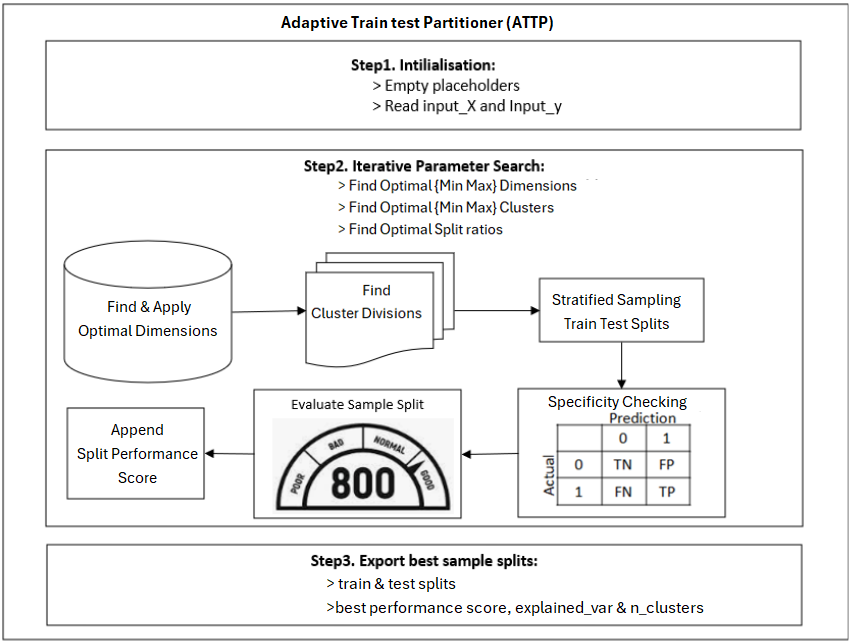

# attp (Adaptive Train Test Partitioner)

Cluster-stratified train/test splitting on an LDA-reduced feature space (S-ATTP).

Instead of stratifying on the class label alone, `sattp` also stratifies on *where a row sits in
feature space*, so the test set covers the same sub-populations as the train set.

## How it works

1. Reduce the features with **LDA**, using the fewest components that reach 85% of the explained
   variance (configurable).
2. For each candidate cluster count, run **K-Means** once on the LDA components and reuse those
   clusters across candidate train fractions (`MiniBatchKMeans` above 50,000 rows).
3. Build strata from `class × cluster` and do a stratified split. Strata with a single member
   can't be split, so those rows always go to the train set.
4. Score a classifier on every `(train fraction, n_clusters)` pair and return the split with the
   best test score.

## Process Flow Diagram


## Install

```bash
pip install i-attp
```

Or install directly from GitHub:

```bash
pip install git+https://github.com/Jabualani/ATTP.git
```

For development:

```bash
git clone https://github.com/Jabualani/ATTP.git
cd ATTP
pip install -e ".[dev]"
pytest
```

## Version history and migration

| Version | Main functionality |
| --- | --- |
| `0.1.2` | The original S-ATTP classifier split, exposed as `sattp_split`, plus the legacy `S_ATTP` wrapper. |
| `0.2.0` | The classifier's preferred name is `s_attp_clf`; `sattp_split` and `S_ATTP` remain available. Adds classification, regression, time-series, and clustering variants, including `s_attp_clustered_sampling`. |

The `0.2.0` release also adds the optional `dr_reducer=True` output for retrieving a fitted
dimensionality reducer. The original `s_attp_clf` call continues to return its `SplitResult` by
default; most added variants return `(X_train, X_test, y_train, y_test)`, while time-series,
pool, clustering, and outlier/inlier methods have their own output shapes as documented below.

To migrate from `0.1.2`, prefer the new import name:

```python
from attp import s_attp_clf

result = s_attp_clf(X, y)
```

Existing code can continue importing `sattp_split` or `S_ATTP`. No version bump is needed for
documentation-only changes. For future releases, reserve patch increments for bug fixes and
documentation-only package updates, and use a minor increment for backward-compatible API additions
while the project remains in the `0.x` series. Review return shapes and behavior before each release.

## Classification usage

```python
from attp import s_attp_clf

result = s_attp_clf(
    X, y,
    splits=[0.7, 0.75, 0.8],   # candidate train fractions
    min_clusters=2,
    max_clusters=10,
)

X_train, y_train, X_test, y_test = result      # unpacks like a 4-tuple
print(result.best_split, result.best_n_clusters, result.n_lda_components)
print(result.explained_variance_ratio)          # ratio explained by each LDA component
print(result.total_explained_variance)           # combined ratio for the selected components
print(result.metrics.head())                    # every candidate, best first
```

Row labels of the original `X`/`y` are preserved in the outputs.

`s_attp_clf` is the current name for the original S-ATTP split function. The previous
`sattp_split` name remains available as a backward-compatible alias.

Useful options: `model=` (any scikit-learn classifier used for scoring; defaults to LDA),
`scoring=` (custom `(fitted_model, X, y) -> float`), `variance_threshold=`, `random_state=`,
`test_size=` to provide one holdout size (otherwise `splits` contains candidate train fractions),
and `verbose=True` to print progress and the selected split. Set `DR_Comps_Min=` and
`DR_Comps_Max=` to choose the LDA component range.

Set `dr_reducer=True` on any splitter to receive `(normal_output, reducer)`. The reducer is the
fitted LDA, PCA, or PLS estimator where that method uses one; splitters that do not reduce features
return `None` as the reducer. The default `dr_reducer=False` preserves the normal return value.

Other variants return scikit-learn-ordered tuples: `(X_train, X_test, y_train, y_test)`;
pool and clustering functions without targets return `(X_train, X_test)`.

```python
from attp import (
    b_attp_clf, m_attp_clf, mc_mcls_attp_clf,
    s_attp_reg, m_attp_reg, r_t_attp, r_f_attp,
    s_attp_ts, s_attp_clustered_sampling,
)

# PCA/GMM classifier split; random oversampling is applied to training rows only.
X_train, X_test, y_train, y_test = m_attp_clf(X, y, test_size=0.2)
X_train, X_test, y_train, y_test = b_attp_clf(X, y, test_size=0.2)

# Regression: target-bin and feature-aware options.
X_train, X_test, y_train, y_test = s_attp_reg(X, y, test_size=0.2)
X_train, X_test, y_train, y_test = m_attp_reg(X, y, test_size=0.2)
r_t_attp(X, y)  # target-bin stratification
r_f_attp(X, y)  # feature-cluster stratification

# Temporal splits preserve row order; clustered sampling accepts labeled or unlabeled data.
X_train, X_test, y_train, y_test = s_attp_ts(X, y)
X_train, X_test = s_attp_clustered_sampling(X)
```

`s_attp_clustered_sampling` supports mixed data with imputation/encoding, date and
high-missingness column removal,
correlation filtering, supervised LDA or unsupervised PCA, optional outlier/inlier partitioning,
and stratified cluster sampling. For example:

```python
from attp import s_attp_clustered_sampling

X_train, X_test, y_train, y_test = s_attp_clustered_sampling(
    X, y, test_size=0.2, n_clusters=5
)
X_inliers, X_outliers = s_attp_clustered_sampling(X, o_i=True)
```

The [ATTP Framework Reference Architecture Documentation](<./ATTP Framework Reference Architecture Documentation.pdf>)
describes the library's concepts and variants. It is included in the GitHub repository and in the
installed `attp` package.

Set `dr_reducer=True` to append the fitted reducer to the normal result; it is `None` only when
supervised reduction cannot be applied (for example, a single target class).

The package also exports `auto_attp_clf`, `auto_attp_reg`, `auto_attp_ts`,
`auto_attp_al_clf`, `auto_attp_al_reg`, `mc_mcls_attp_reg`, `r_tf_attp`,
`r_ra_attp`, `r_d_attp`, `m_attp_ts`, and `m_attp_cluster`.

### Original function signature

`S_ATTP` keeps the original call signature for existing code:

```python
from attp import S_ATTP

X_tr, y_tr, X_te, y_te = S_ATTP(
    X_df, y_df, "target_col", [0.7, 0.8], 2, 10, 1, 3, None, "frames", False, False
)
```

`return_type="indices"` returns `(train_index, test_index)`, and
`return_split_metadata=True` appends the metrics DataFrame. If no valid split exists it returns
`None`s, like the original.

## Caveats

- LDA is fitted on the **whole** dataset (using all labels) before splitting, and the winning
  split is chosen by its **test** score. Both make the reported test score optimistic. Treat it as
  a way to build a representative split, not as an unbiased performance estimate.
- Features must be numeric with no missing values.

## License

MIT